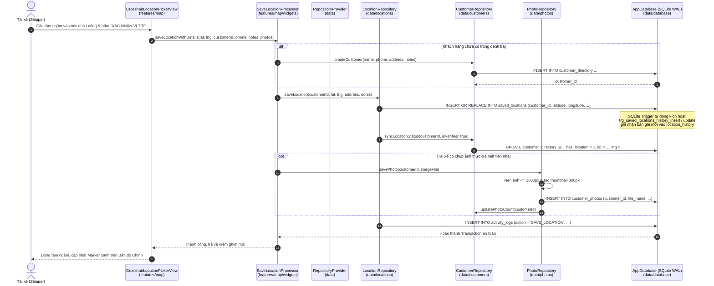

# Cấu Trúc Mã Nguồn Ứng Dụng (Code Structure)

> **Tài liệu chuẩn hóa kiến trúc thư mục, luồng dữ liệu và quy ước mã nguồn cho ứng dụng Delivery Location Marker System (Mobile App).**  
> **Nhánh:** `testrutgoncode` | **Phiên bản:** Local-First Offline | **Quy chuẩn:** [AGENTS.md](AGENTS.md)

---

## 1. Sơ Đồ Cấu Trúc Thư Mục (Folder Tree)

Ứng dụng được tổ chức theo kiến trúc phân tầng kết hợp hướng tính năng (Feature-First + Domain-Driven Data Layer), đặt toàn bộ mã nguồn giao hàng ngoại tuyến độc lập không phụ thuộc máy chủ:

```
mobile_app/lib/
├── main.dart                          # Điểm khởi chạy ứng dụng (runApp), khởi tạo dịch vụ
├── app/                               # Khung điều hướng gốc, chủ đề giao diện và màn khởi động
│   ├── app.dart                       # Root MaterialApp, cấu hình ThemeMode & routes
│   ├── auth_splash_view.dart          # Màn Splash, dọn ảnh tạm 30 ngày, mở khóa PIN
│   ├── home_shell_view.dart           # Khung điều hướng 4 tab (Bản đồ, Danh bạ, Ca, Cá nhân)
│   └── theme/                         # Hệ thống màu sắc và quy chuẩn nút bấm Material 3
│       ├── app_theme.dart             # Token màu sắc, Light theme và Dark theme
│       └── app_buttons.dart           # Quy chuẩn kích thước và style các nút bấm
├── core/                              # Nền tảng dùng chung không phụ thuộc nghiệp vụ
│   ├── constants/                     # Hằng số cấu hình toàn cục
│   ├── services/                      # Dịch vụ nền (Cache tile bản đồ, chỉ đường ngoài)
│   │   ├── map_navigation_service.dart
│   │   └── map_tile_cache_service.dart
│   ├── theme/                         # Cầu nối tương thích import theme
│   ├── utils/                         # Tiện ích tính toán (chuẩn hóa SĐT, mã hóa PIN, AES-GCM)
│   │   ├── phone_utils.dart
│   │   ├── pin_crypto_utils.dart
│   │   ├── share_crypto_utils.dart
│   │   └── vietnamese_utils.dart
│   └── widgets/                       # Các widget tái sử dụng trên nhiều tính năng
│       ├── authenticated_image.dart   # Hiển thị ảnh an toàn kèm bộ nhớ đệm
│       ├── bulk_section_header.dart   # Tiêu đề nhóm kết quả phân loại SĐT
│       ├── point_detail_bottom_sheet.dart # Sheet chi tiết điểm ghim & thao tác nhanh
│       ├── quick_add_customer_sheet.dart  # Sheet thêm nhanh khách hàng
│       ├── bulk_paste_phone_sheet.dart    # Sheet dán danh sách SĐT hàng loạt
│       ├── bulk_paste/                # Các thành phần giao diện của sheet dán SĐT
│       ├── point_detail/              # Các nút thao tác của sheet chi tiết điểm
│       └── quick_add/                 # Form trường dữ liệu thêm nhanh
├── data/                              # Tầng dữ liệu phân chia theo miền nghiệp vụ
│   ├── repository_provider.dart       # Quản lý vòng đời và cung cấp Singleton Repositories
│   ├── database/                      # Kết nối SQLite, Schema và Migration
│   │   ├── app_database.dart          # Quản lý kết nối SQLite WAL và transaction
│   │   ├── app_database_schema.dart   # DDL bảng dữ liệu, chỉ mục và triggers
│   │   └── app_database_migrations.dart # Script nâng cấp cấu trúc CSDL an toàn
│   ├── customers/                     # Nghiệp vụ khách hàng danh bạ
│   │   ├── customer_repository.dart   # Repository CRUD khách hàng, tìm kiếm
│   │   └── customer_queries.dart      # Câu truy vấn SQL danh bạ và bulk insert
│   ├── locations/                     # Nghiệp vụ tọa độ điểm ghim thực địa
│   │   ├── location_repository.dart   # Repository lưu điểm ghim và lịch sử
│   │   └── location_queries.dart      # Câu truy vấn SQL vị trí điểm ghim
│   ├── shifts/                        # Nghiệp vụ ca giao hàng
│   │   ├── shift_repository.dart      # Repository tạo, đổi tên, xóa, chốt ca
│   │   ├── shift_queries.dart         # Câu truy vấn SQL danh sách ca
│   │   ├── shift_point_ops.dart       # Xử lý mốc giao, thứ tự lộ trình
│   │   └── shift_bulk_helpers.dart    # Phân loại SĐT và nạp mốc vào ca
│   ├── photos/                        # Quản lý ảnh thực địa mặt tiền nhà
│   │   └── photo_repository.dart      # Nén ảnh, thumbnail, xóa mềm và dọn rác
│   ├── backup/                        # Sao lưu và phục hồi dữ liệu ZIP
│   │   ├── backup_service.dart        # Đóng gói và giải nén gói ZIP kèm checksum
│   │   └── app_storage_service.dart   # Quản lý đường dẫn bộ nhớ máy và file tạm
│   ├── sharing/                       # Chia sẻ điểm giao P2P ngoại tuyến
│   │   ├── sharing_repository.dart    # Điều phối tạo và tiếp nhận gói chia sẻ
│   │   ├── sharing_export_ops.dart    # Đóng gói và mã hóa file .dshare AES-GCM
│   │   └── sharing_import_ops.dart    # Giải mã và nhập điểm giao vào máy
│   └── profile/                       # Thông tin tài xế và bảo mật mã PIN
│       └── profile_repository.dart    # Lưu cấu hình, PIN bảo vệ, thời gian khóa
├── features/                          # Giao diện người dùng theo từng tính năng
│   ├── map/                           # Bản đồ chính và công cụ ghim vị trí thực địa
│   │   ├── main_map_view.dart         # Màn hình Bản đồ Chính (Tab 0)
│   │   ├── crosshair_location_picker_view.dart # Màn hình tâm ngắm định vị chuẩn xác
│   │   ├── main_map_view_handlers.dart # Xử lý sự kiện chạm và tương tác bản đồ
│   │   └── widgets/                   # Điều khiển bản đồ, marker layer, overlay
│   ├── directory/                     # Danh bạ khách hàng (Tab 1)
│   │   ├── customer_directory_view.dart # Danh sách danh bạ tìm kiếm tức thì
│   │   ├── customer_detail_edit_view.dart # Chi tiết và chỉnh sửa khách hàng
│   │   └── widgets/                   # Thẻ khách hàng, tab lọc, thanh tìm kiếm
│   ├── shifts/                        # Quản lý ca làm việc (Tab 2)
│   │   ├── shift_list_view.dart       # Danh sách ca (Tab 2)
│   │   ├── shift_preparation_view.dart # Chuẩn bị ca, sắp xếp lộ trình mốc giao
│   │   ├── shift_map_view.dart        # Bản đồ ca chuyên dụng theo mốc đánh số
│   │   └── widgets/                   # Thẻ ca, hộp thoại ca, selector sheet
│   ├── profile/                       # Hồ sơ cá nhân và cài đặt (Tab 3)
│   │   ├── account_profile_view.dart  # Màn hình Cá nhân / Tài khoản (Tab 3)
│   │   └── widgets/                   # Cài đặt mã PIN, sao lưu ZIP, chia sẻ P2P
│   ├── sharing/                       # Giao diện truyền file và quét mã QR P2P
│   │   ├── data_share_send_sheet.dart # Sheet tạo gói gửi dữ liệu
│   │   ├── data_share_import_preview_sheet.dart # Sheet đối soát và nhập dữ liệu
│   │   ├── data_share_qr_view.dart    # Trình chiếu mã QR động
│   │   ├── data_share_qr_scanner_view.dart # Quét camera mã QR nhiều mảnh
│   │   └── widgets/                   # Thẻ xem trước mốc giao, tùy chọn nhập
│   ├── photos/                        # Quản lý ảnh thực địa
│   │   ├── fullscreen_image_viewer.dart # Trình xem ảnh toàn màn hình zoom 5.0x
│   │   ├── customer_photos_strip_widget.dart # Dải ảnh ngang chụp ảnh thực địa
│   │   └── photo_strip_item.dart      # Thumbnail ảnh trong dải ảnh
│   └── onboarding_lock/               # Khởi tạo lần đầu và khóa ứng dụng
│       ├── welcome_onboarding_view.dart # Màn hình chào mừng mở app lần đầu
│       └── pin_lock_view.dart         # Màn hình bàn phím khóa mã PIN bảo mật
└── models/                            # Domain Data Models
    ├── customer_model.dart            # Model khách hàng danh bạ
    ├── customer_photo_model.dart      # Model ảnh mặt tiền nhà
    ├── local_share_models.dart        # Model gói chia sẻ P2P
    ├── saved_location_model.dart      # Model vị trí điểm ghim
    ├── shift_model.dart               # Model ca làm việc và mốc giao
    └── user_profile.dart              # Model hồ sơ tài xế
```

---

## 2. Luồng Dữ Liệu Một Tính Năng Mẫu: Ghim Vị Trí Thực Địa

Sơ đồ tuần tự thể hiện toàn bộ luồng dữ liệu khi tài xế thực hiện ghim hoặc cập nhật vị trí cho một khách hàng từ màn hình tâm ngắm:



---

## 3. Quy Ước Đặt Tên (Naming Conventions)

Toàn bộ dự án tuân thủ nghiêm ngặt các quy tắc định dạng và hậu tố mô tả mục đích:

1. **Định dạng tệp tin:** Sử dụng `snake_case` toàn bộ chữ thường, phân cách bằng dấu gạch dưới:
   - *Đúng:* `crosshair_location_picker_view.dart`, `shift_picker_bottom_sheet.dart`.
   - *Sai:* `CrosshairPicker.dart`, `shiftPickerBottomSheet.dart`.
2. **Quy tắc hậu tố tệp tin (File Suffixes):**
   - **`_view.dart`:** Màn hình độc lập (Scaffold) chiếm trọn viewport hoặc đóng vai trò tab (ví dụ: `main_map_view.dart`, `customer_directory_view.dart`, `shift_list_view.dart`).
   - **`_sheet.dart`:** Khung giao diện dạng trượt từ dưới lên (Modal Bottom Sheet) cho các luồng thao tác phức tạp (ví dụ: `quick_add_customer_sheet.dart`, `bulk_paste_phone_sheet.dart`, `data_share_send_sheet.dart`).
   - **`_dialog.dart` hoặc `_dialogs.dart`:** Hộp thoại cảnh báo hoặc xác nhận ngắn gọn (ví dụ: `create_shift_dialog.dart`, `shift_dialogs.dart`).
   - **`_repository.dart`:** Lớp quản trị logic nghiệp vụ và truy xuất dữ liệu trung gian giữa UI và CSDL (ví dụ: `customer_repository.dart`, `shift_repository.dart`).
   - **`_queries.dart`:** Tệp chứa các câu lệnh SQL thuần túy phục vụ truy vấn theo domain.
   - **`_model.dart`:** Định nghĩa kiểu dữ liệu Data Class / Entity.
3. **Quy tắc giới hạn độ dài:** Không tạo bất kỳ tệp nào vượt quá **400 dòng mã**. Khi một tệp tiếp cận 350 dòng, phải chủ động tách các phần logic chuyên biệt (như ops, queries, sub-widgets) thành các file vệ tinh cùng thư mục.
4. **Chú thích tệp tiếng Việt:** Mọi tệp có độ dài trên 100 dòng bắt buộc phải có từ 2-3 dòng chú thích tiếng Việt ở đầu tệp giải thích chức năng chính và vai trò của tệp trong hệ thống.

---

## 4. Hướng Dẫn "Muốn Sửa X Thì Mở File Nào"

Bảng tra cứu nhanh giúp kỹ sư mới có thể ngay lập tức định vị đúng tệp cần sửa mà không mất thời gian tìm kiếm:

| Nghiệp Vụ / Thành Phần Cần Thay Đổi (X) | Tệp Mã Nguồn Cần Mở | Thư Mục |
| :--- | :--- | :--- |
| **Giao diện 4 Tab chính (Bản đồ, Danh bạ, Ca, Cá nhân)** | `home_shell_view.dart` | `lib/app/` |
| **Màu sắc giao diện, Dark mode, màu thương hiệu** | `app_theme.dart` | `lib/app/theme/` |
| **Kiểu dáng nút bấm (nút chính màu đen, nút phụ, nút xóa)** | `app_buttons.dart` | `lib/app/theme/` |
| **Màn hình Splash, logic mở app lần đầu & mã PIN khởi động** | `auth_splash_view.dart` | `lib/app/` |
| **Thêm / đổi cột bảng SQLite hoặc nâng cấp version DB** | `app_database_schema.dart` & `app_database_migrations.dart` | `lib/data/database/` |
| **Ghim vị trí trên bản đồ, điều khiển tâm ngắm** | `crosshair_location_picker_view.dart` | `lib/features/map/` |
| **Vẽ Marker shipper, marker điểm giao trên Bản đồ Chính** | `map_markers_builder.dart` | `lib/features/map/widgets/` |
| **Thẻ xem trước thông tin mốc khi bấm vào Marker bản đồ** | `map_overlay_widgets.dart` & `point_detail_bottom_sheet.dart` | `lib/features/map/widgets/` & `lib/core/widgets/` |
| **Chỉ đường sang Google Maps / Apple Maps ngoài** | `map_navigation_service.dart` | `lib/core/services/` |
| **Tìm kiếm danh bạ khách hàng, lọc theo khu vực** | `customer_directory_view.dart` & `customer_queries.dart` | `lib/features/directory/` & `lib/data/customers/` |
| **Sửa thông tin khách hàng, số điện thoại, ghi chú** | `customer_detail_edit_view.dart` & `customer_repository.dart` | `lib/features/directory/` & `lib/data/customers/` |
| **Bóc tách danh sách SĐT dán từ Zalo/tin nhắn hàng loạt** | `bulk_paste_phone_sheet.dart` | `lib/core/widgets/` |
| **Logic nạp SĐT hàng loạt vào ca làm việc** | `shift_bulk_helpers.dart` | `lib/data/shifts/` |
| **Bản đồ ca làm việc & điều hướng lộ trình mốc giao** | `shift_map_view.dart` & `shift_map_overlay_widgets.dart` | `lib/features/shifts/` |
| **Tạo ca mới, đổi tên ca hoặc xóa ca làm việc** | `shift_dialogs.dart` & `shift_repository.dart` | `lib/features/shifts/widgets/` & `lib/data/shifts/` |
| **Chụp ảnh thực địa mặt tiền, nén ảnh, xem phóng to** | `customer_photos_strip_widget.dart` & `photo_repository.dart` | `lib/features/photos/` & `lib/data/photos/` |
| **Cài đặt mã PIN, đổi mã PIN, chỉnh thời gian khóa** | `pin_settings_bottom_sheet.dart` & `pin_lock_view.dart` | `lib/features/profile/widgets/` & `lib/features/onboarding_lock/` |
| **Xuất / Nhập gói sao lưu toàn bộ máy dạng .zip** | `backup_restore_bottom_sheet.dart` & `backup_service.dart` | `lib/features/profile/widgets/` & `lib/data/backup/` |
| **Xuất / Nhập gói chia sẻ điểm giao .dshare qua mã QR / File** | `data_share_send_sheet.dart`, `data_share_import_preview_sheet.dart` & `sharing_repository.dart` | `lib/features/sharing/` & `lib/data/sharing/` |
| **Cung cấp Singleton truy cập dữ liệu toàn cục** | `repository_provider.dart` | `lib/data/` |
