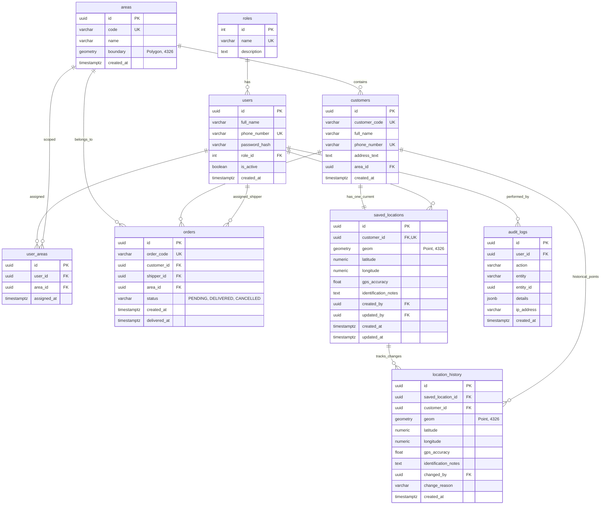

# Database Documentation: Delivery Location Marker System

> **Tài liệu đặc tả Cơ sở dữ liệu quan hệ và không gian địa lý (PostgreSQL 16 + PostGIS 3.4).**

---

## 1. Công Nghệ & Tiện Ích Mở Rộng (Engine & Extensions)

- **Hệ quản trị CSDL:** PostgreSQL 16
- **Tiện ích Không gian:** PostGIS 3.4 (Cung cấp kiểu dữ liệu `GEOMETRY`, chỉ mục không gian `GIST`, các hàm toán học không gian `ST_MakePoint`, `ST_SetSRID`).
- **Tiện ích UUID:** `uuid-ossp` (Hàm `uuid_generate_v4()` phục vụ sinh khóa chính UUID ngẫu nhiên không xung đột).
- **Hệ quy chiếu tọa độ:** WGS 84 (SRID 4326) - Hệ tọa độ chuẩn toàn cầu sử dụng trong GPS và bản đồ số.

---

## 2. Sơ Đồ Quan Hệ Thực Thể (Entity-Relationship Diagram)



---

## 3. Từ Điển Dữ Liệu Chi Tiết (Data Dictionary)

### 3.1. Bảng `roles` (Vai trò người dùng)
| Cột | Kiểu Dữ Liệu | Ràng Buộc | Ý Nghĩa Nghiệp Vụ |
| :--- | :--- | :--- | :--- |
| `id` | SERIAL | PRIMARY KEY | Khóa chính tự tăng |
| `name` | VARCHAR(50) | NOT NULL, UNIQUE | Tên vai trò (`ADMIN`, `SHIPPER`) |
| `description` | TEXT | NULLABLE | Mô tả quyền hạn của vai trò |

### 3.2. Bảng `users` (Tài khoản người dùng)
| Cột | Kiểu Dữ Liệu | Ràng Buộc | Ý Nghĩa Nghiệp Vụ |
| :--- | :--- | :--- | :--- |
| `id` | UUID | PRIMARY KEY, DEFAULT uuid_generate_v4() | Định danh người dùng duy nhất |
| `full_name` | VARCHAR(100) | NOT NULL | Họ và tên |
| `phone_number` | VARCHAR(20) | NOT NULL, UNIQUE | Số điện thoại dùng làm tên đăng nhập |
| `password_hash`| VARCHAR(255) | NOT NULL | Mật khẩu đã băm (Bcrypt hash) |
| `role_id` | INT | NOT NULL, REFERENCES roles(id) | Khóa ngoại vai trò |
| `is_active` | BOOLEAN | DEFAULT TRUE | Trạng thái kích hoạt tài khoản |
| `created_at` | TIMESTAMPTZ | DEFAULT CURRENT_TIMESTAMP | Thời điểm tạo tài khoản |

### 3.3. Bảng `areas` (Khu vực quản lý giao hàng)
| Cột | Kiểu Dữ Liệu | Ràng Buộc | Ý Nghĩa Nghiệp Vụ |
| :--- | :--- | :--- | :--- |
| `id` | UUID | PRIMARY KEY, DEFAULT uuid_generate_v4() | Khóa chính khu vực |
| `code` | VARCHAR(50) | NOT NULL, UNIQUE | Mã định danh khu vực (VD: `AREA_Q9_01`) |
| `name` | VARCHAR(150) | NOT NULL | Tên hiển thị khu vực |
| `boundary` | GEOMETRY(Polygon, 4326) | NULLABLE | Đa giác ranh giới địa lý theo chuẩn WGS 84 |
| `created_at` | TIMESTAMPTZ | DEFAULT CURRENT_TIMESTAMP | Thời điểm tạo |

### 3.4. Bảng `user_areas` (Phân công khu vực cho nhân viên)
| Cột | Kiểu Dữ Liệu | Ràng Buộc | Ý Nghĩa Nghiệp Vụ |
| :--- | :--- | :--- | :--- |
| `id` | UUID | PRIMARY KEY, DEFAULT uuid_generate_v4() | Khóa chính bản ghi phân công |
| `user_id` | UUID | NOT NULL, REFERENCES users(id) ON DELETE CASCADE | Nhân viên được phân công |
| `area_id` | UUID | NOT NULL, REFERENCES areas(id) ON DELETE CASCADE | Khu vực được giao |
| `assigned_at` | TIMESTAMPTZ | DEFAULT CURRENT_TIMESTAMP | Ngày phân công |
| *Ràng buộc cặp* | UNIQUE(user_id, area_id) | `uq_user_area` | Chống gán trùng lặp cùng 1 khu vực |

### 3.5. Bảng `customers` (Khách hàng nhận hàng)
| Cột | Kiểu Dữ Liệu | Ràng Buộc | Ý Nghĩa Nghiệp Vụ |
| :--- | :--- | :--- | :--- |
| `id` | UUID | PRIMARY KEY, DEFAULT uuid_generate_v4() | Khóa chính khách hàng |
| `customer_code`| VARCHAR(50) | NOT NULL, UNIQUE | Mã khách hàng (VD: `KH_001`) |
| `full_name` | VARCHAR(100) | NOT NULL | Tên khách hàng / người nhận |
| `phone_number` | VARCHAR(20) | NOT NULL, UNIQUE | Số điện thoại liên hệ |
| `address_text` | TEXT | NOT NULL | Địa chỉ chữ ghi trên đơn hàng/hóa đơn |
| `area_id` | UUID | NOT NULL, REFERENCES areas(id) | Khu vực quản lý khách hàng |
| `created_at` | TIMESTAMPTZ | DEFAULT CURRENT_TIMESTAMP | Thời điểm tạo |

### 3.6. Bảng `orders` (Đơn hàng giao trong ca)
| Cột | Kiểu Dữ Liệu | Ràng Buộc | Ý Nghĩa Nghiệp Vụ |
| :--- | :--- | :--- | :--- |
| `id` | UUID | PRIMARY KEY, DEFAULT uuid_generate_v4() | Khóa chính đơn hàng |
| `order_code` | VARCHAR(50) | NOT NULL, UNIQUE | Mã vận đơn (VD: `ORD-20261004-01`) |
| `customer_id` | UUID | NOT NULL, REFERENCES customers(id) | Khách hàng nhận đơn |
| `shipper_id` | UUID | NULLABLE, REFERENCES users(id) | Shipper được giao đơn |
| `area_id` | UUID | NOT NULL, REFERENCES areas(id) | Khu vực giao hàng |
| `status` | VARCHAR(20) | DEFAULT 'PENDING' CHECK (status IN ('PENDING', 'DELIVERED', 'CANCELLED')) | Trạng thái giao hàng |
| `created_at` | TIMESTAMPTZ | DEFAULT CURRENT_TIMESTAMP | Ngày tạo đơn |
| `delivered_at`| TIMESTAMPTZ | NULLABLE | Thời điểm giao thành công |

### 3.7. Bảng `saved_locations` (Vị trí thực tế đã lưu của khách hàng)
| Cột | Kiểu Dữ Liệu | Ràng Buộc | Ý Nghĩa Nghiệp Vụ |
| :--- | :--- | :--- | :--- |
| `id` | UUID | PRIMARY KEY, DEFAULT uuid_generate_v4() | Khóa chính vị trí |
| `customer_id` | UUID | NOT NULL, UNIQUE, REFERENCES customers(id) ON DELETE CASCADE | Một khách hàng chỉ có duy nhất 1 vị trí hiện hành |
| `geom` | GEOMETRY(Point, 4326) | NOT NULL | Đối tượng điểm không gian PostGIS (SRID 4326) |
| `latitude` | NUMERIC(10, 7)| NOT NULL | Tọa độ vĩ độ (WGS 84) |
| `longitude`| NUMERIC(10, 7)| NOT NULL | Tọa độ kinh độ (WGS 84) |
| `gps_accuracy`| FLOAT | NOT NULL DEFAULT 0.0 | Sai số định vị GPS tại thời điểm đo (±m) |
| `identification_notes`| TEXT | NOT NULL | Ghi chú nhận diện thực tế (cổng, ngõ, nhà kế bên) |
| `image_url` | TEXT | NULLABLE | Đường dẫn ảnh mặt tiền/cổng nhà nhận diện |
| `created_by` | UUID | NULLABLE, REFERENCES users(id) | Nhân viên đầu tiên lưu vị trí |
| `updated_by` | UUID | NULLABLE, REFERENCES users(id) | Nhân viên cập nhật vị trí gần nhất |
| `created_at` | TIMESTAMPTZ | DEFAULT CURRENT_TIMESTAMP | Ngày lưu đầu tiên |
| `updated_at` | TIMESTAMPTZ | DEFAULT CURRENT_TIMESTAMP | Ngày cập nhật gần nhất |

### 3.8. Bảng `location_history` (Lịch sử thay đổi vị trí)
| Cột | Kiểu Dữ Liệu | Ràng Buộc | Ý Nghĩa Nghiệp Vụ |
| :--- | :--- | :--- | :--- |
| `id` | UUID | PRIMARY KEY, DEFAULT uuid_generate_v4() | Khóa chính bản ghi lịch sử |
| `saved_location_id` | UUID | NULLABLE, REFERENCES saved_locations(id) ON DELETE SET NULL | Liên kết vị trí gốc (bảo toàn lịch sử khi xóa vị trí) |
| `customer_id` | UUID | NOT NULL, REFERENCES customers(id) | Khách hàng liên quan |
| `geom` | GEOMETRY(Point, 4326) | NOT NULL | Tọa độ cũ trước khi bị thay đổi |
| `latitude` | NUMERIC(10, 7)| NOT NULL | Vĩ độ cũ |
| `longitude`| NUMERIC(10, 7)| NOT NULL | Kinh độ cũ |
| `gps_accuracy`| FLOAT | NOT NULL | Sai số GPS cũ |
| `identification_notes`| TEXT | NOT NULL | Ghi chú nhận diện cũ |
| `image_url` | TEXT | NULLABLE | Ảnh nhận diện cũ trước khi cập nhật |
| `changed_by` | UUID | NULLABLE, REFERENCES users(id) | Người thực hiện cập nhật |
| `change_reason` | VARCHAR(255) | DEFAULT 'Cập nhật vị trí' | Lý do thay đổi |
| `created_at` | TIMESTAMPTZ | DEFAULT CURRENT_TIMESTAMP | Thời điểm ghi nhận lịch sử |

### 3.9. Bảng `audit_logs` (Nhật ký kiểm toán thao tác hệ thống)
| Cột | Kiểu Dữ Liệu | Ràng Buộc | Ý Nghĩa Nghiệp Vụ |
| :--- | :--- | :--- | :--- |
| `id` | UUID | PRIMARY KEY, DEFAULT uuid_generate_v4() | Khóa chính log |
| `user_id` | UUID | NULLABLE, REFERENCES users(id) | Người thực hiện hành động |
| `action` | VARCHAR(50) | NOT NULL | Mã hành động (`LOGIN`, `CREATE_LOCATION`, `UPDATE_LOCATION`, `DELETE_LOCATION`) |
| `entity` | VARCHAR(50) | NOT NULL | Đối tượng bị tác động (`USER`, `SAVED_LOCATION`, `SYSTEM`) |
| `entity_id` | UUID | NULLABLE | Khóa ID đối tượng bị tác động |
| `details` | JSONB | NULLABLE | Dữ liệu chi tiết dạng JSON (payload, IP) |
| `ip_address` | VARCHAR(45) | NULLABLE | Địa chỉ IP máy khách |
| `created_at` | TIMESTAMPTZ | DEFAULT CURRENT_TIMESTAMP | Thời điểm ghi log |

---

## 4. Chỉ Mục & Tối Ưu Hóa Truy Vấn (Indexes)

1. **Chỉ mục Không gian (Spatial Index - GIST):**
   ```sql
   CREATE INDEX idx_saved_locations_geom ON saved_locations USING GIST (geom);
   CREATE INDEX idx_location_history_geom ON location_history USING GIST (geom);
   ```
   - **Tác dụng:** Cho phép thực hiện các phép truy vấn tìm kiếm không gian (như tìm kiếm điểm trong bán kính, điểm nằm trong vùng bao `ST_Contains`, tính khoảng cách `ST_Distance`) với độ phức tạp `O(log N)` thay vì quét toàn bảng.
2. **Chỉ mục Cây B-Tree thông thường (B-Tree Indexes):**
   - `idx_users_phone`: Tối ưu hóa truy vấn đăng nhập theo số điện thoại.
   - `idx_customers_phone` & `idx_customers_area_id`: Tối ưu hóa tra cứu khách hàng và lọc theo khu vực.
   - `idx_orders_shipper_status`: Tối ưu hóa truy vấn danh sách đơn hàng trong ca của shipper theo trạng thái (`WHERE shipper_id = $1 AND status = 'PENDING'`).
   - `idx_user_areas_user`: Tối ưu hóa việc lấy danh sách khu vực gán cho user lúc đăng nhập.
   - `idx_saved_locations_customer`: Tối ưu hóa liên kết `LEFT JOIN saved_locations` theo `customer_id`.

---

## 5. Triggers & Tự Động Hóa Lưu Vết (Automated Audit Trail)

Hệ thống cài đặt trigger tự động sao lưu lịch sử vị trí khi có thao tác `UPDATE`:

```sql
CREATE OR REPLACE FUNCTION fn_log_location_history()
RETURNS TRIGGER AS $$
BEGIN
    INSERT INTO location_history (
        saved_location_id,
        customer_id,
        geom,
        latitude,
        longitude,
        gps_accuracy,
        identification_notes,
        changed_by,
        change_reason,
        created_at
    ) VALUES (
        OLD.id,
        OLD.customer_id,
        OLD.geom,
        OLD.latitude,
        OLD.longitude,
        OLD.gps_accuracy,
        OLD.identification_notes,
        NEW.updated_by,
        'Cập nhật thông tin vị trí cũ sang vị trí mới',
        CURRENT_TIMESTAMP
    );
    RETURN NEW;
END;
$$ LANGUAGE plpgsql;

CREATE TRIGGER trg_saved_locations_history
AFTER UPDATE ON saved_locations
FOR EACH ROW
WHEN (OLD.latitude IS DISTINCT FROM NEW.latitude OR
      OLD.longitude IS DISTINCT FROM NEW.longitude OR
      OLD.identification_notes IS DISTINCT FROM NEW.identification_notes)
EXECUTE FUNCTION fn_log_location_history();
```

---

## 6. Rủi Ro Tính Toàn Vẹn Dữ Liệu Cần Khắc Phục (Integrity Risks)

- **Nguy cơ mất lịch sử khi xóa vị trí (`CASCADE DELETE`):**
  - Trong khai báo bảng [01-init-db.sql:L102](file:///d:/flutter create delivery_marker_app/init-db/01-init-db.sql#L102):
    `saved_location_id UUID NOT NULL REFERENCES saved_locations(id) ON DELETE CASCADE`
  - Khi Admin gọi API `DELETE /admin/locations/:id` ([admin.controller.ts:L184](file:///d:/flutter create delivery_marker_app/backend/src/controllers/admin.controller.ts#L184)), cơ chế cascade sẽ **xóa sạch toàn bộ lịch sử vị trí cũ** trong `location_history`.
  - **Khuyến nghị cho Architect:** Thay đổi sang cơ chế **Soft Delete** (thêm cột `deleted_at TIMESTAMPTZ` vào `saved_locations`) hoặc chuyển khóa ngoại `saved_location_id` trong `location_history` sang `ON DELETE SET NULL` / giữ nguyên bản ghi lịch sử độc lập.

---

## 7. Cấu Trúc CSDL SQLite Ngoại Tuyến Mobile (Offline Storage & Quarantine Schema)

Trên ứng dụng Flutter Mobile (`delivery_offline_v2.db`), dữ liệu ngoại tuyến và quá trình chuyển đổi từ v1 được quản lý qua 4 bảng chính:

### 7.1. Bảng `cached_orders`
- `orderId TEXT PRIMARY KEY`: Mã đơn hàng được cache.
- `jsonData TEXT`: Chuỗi JSON đối tượng đơn hàng đầy đủ.

### 7.2. Bảng `offline_sync_queue`
- `id INTEGER PRIMARY KEY AUTOINCREMENT`: Khóa chính cục bộ.
- `customerId TEXT NOT NULL`: Khóa định danh khách hàng (bắt buộc).
- `latitude REAL NOT NULL`: Tọa độ vĩ độ WGS 84 [-90, 90].
- `longitude REAL NOT NULL`: Tọa độ kinh độ WGS 84 [-180, 180].
- `gpsAccuracy REAL NOT NULL`: Độ chính xác đo lường GPS.
- `identificationNotes TEXT NOT NULL`: Ghi chú nhận diện.
- `imageUrl TEXT`, `imageBase64 TEXT`: Ảnh đính kèm.
- `syncStatus TEXT DEFAULT 'PENDING'`: Trạng thái chờ đồng bộ (`PENDING`, `FAILED`).
- `retryCount INTEGER DEFAULT 0`: Số lần đã thử đồng bộ.
- `createdAt TEXT NOT NULL`: Thời điểm tạo bản ghi.

### 7.3. Bảng `_v1_migration_tracking` (Bảo toàn định danh nguồn)
- `v1_source_id INTEGER PRIMARY KEY`: Khóa chính bản ghi nguồn từ v1.
- `v2_queue_id INTEGER NULLABLE`: Khóa ID tương ứng trên v2 (NULL nếu bản ghi bị cách ly).
- `migrated_at TEXT NOT NULL`: Thời điểm xử lý di chuyển.

### 7.4. Bảng `_v1_quarantine_records` (Cơ chế cách ly & đối soát bản ghi lỗi)
Bảo toàn 100% dữ liệu gốc bị lỗi từ v1 mà không xóa dữ liệu, đồng thời hỗ trợ quy trình sửa lỗi, phê duyệt và đưa trở lại hàng đợi đồng bộ:
- `id INTEGER PRIMARY KEY AUTOINCREMENT`: Khóa chính bản ghi cách ly.
- `source_table TEXT NOT NULL DEFAULT 'offline_sync_queue'`: Bảng nguồn v1.
- `v1_source_id INTEGER NULLABLE`: ID bản ghi nguồn v1.
- `raw_data TEXT NOT NULL`: Chuỗi JSON nguyên bản của bản ghi lỗi (bảo toàn nguyên vẹn).
- `error_reason TEXT NOT NULL`: Lý do không thể chuyển đổi (VD: thiếu `customerId`, tọa độ ngoài phạm vi, kiểu dữ liệu sai).
- `quarantined_at TEXT NOT NULL`: Thời điểm phát hiện và đưa vào vùng cách ly.
- `status TEXT NOT NULL DEFAULT 'QUARANTINED'`: Vòng đời bản ghi:
  - `QUARANTINED`: Đang chờ đối soát/hiệu chỉnh.
  - `RESOLVED`: Đã sửa dữ liệu và chuyển thành công sang `offline_sync_queue`.
  - `DISCARDED`: Đã xác nhận loại bỏ (dữ liệu thử nghiệm rác) kèm lý do đối soát.
- `v2_queue_id INTEGER NULLABLE`: ID bản ghi mới được sinh ra trong `offline_sync_queue` sau khi đối soát thành công.
- `resolved_at TEXT NULLABLE`: Thời điểm hoàn tất xử lý đối soát hoặc loại bỏ.
- `resolution_notes TEXT NULLABLE`: Ghi chú phương án xử lý, căn cứ xác minh (số điện thoại, hóa đơn...).
- `resolved_data TEXT NULLABLE`: Chuỗi JSON chứa dữ liệu đã được người dùng/shipper chuẩn hóa và lưu lại.

### 7.5. Quy Tắc Toàn Vẹn Giữa Các Bảng SQLite (Quarantine Integrity Rules)
1. **Không xóa bản ghi cách ly:** Khi sửa lỗi qua `resolveQuarantinedRecord()`, bản ghi chuyển sang trạng thái `RESOLVED` thay vì bị xóa (`DELETE`), đảm bảo lịch sử đối soát và bằng chứng dữ liệu gốc luôn tồn tại.
2. **Giao dịch nguyên tử (Atomic Transaction):** Thao tác đưa dữ liệu vào `offline_sync_queue`, cập nhật `_v1_migration_tracking.v2_queue_id` và cập nhật `_v1_quarantine_records.status = 'RESOLVED'` thực thi trong 1 transaction SQLite duy nhất. Bất kỳ sự cố nào sẽ rollback toàn bộ.
3. **Chống lặp Idempotent:** Khi gọi lại hàm resolve trên bản ghi đã xử lý, hệ thống trả về ngay `v2_queue_id` hiện tại mà không tạo thêm bản ghi mới trong hàng đợi.
4. **An toàn Migration v1:** File CSDL `delivery_offline.db` (v1) luôn được mở với cờ `readOnly: true`, tuyệt đối không ghi hoặc xóa tệp nguồn. Cờ hoàn tất migration chỉ được bật khi toàn bộ bản ghi nguồn đã được chuyển đổi hoặc có trạng thái đối soát bảo toàn (`RESOLVED`/`DISCARDED`).

---

## 8. Quy Chuẩn Seed Dữ Liệu & Khóa Chính UUID (Seed & UUID Conventions)

### 8.1. Quy chuẩn Cú pháp UUID trong PostgreSQL
- PostgreSQL yêu cầu các giá trị kiểu `UUID` phải là chuỗi 32 chữ số hệ thập lục phân (hexadecimal: `0-9`, `a-f`, `A-F`), phân cách bởi 4 dấu gạch nối: `8-4-4-4-12`.
- **Nghiêm cấm** sử dụng các tiền tố ký tự ngoài hệ hex (như `s`, `l`, `o` để chỉ shipper, location, order) vì PostgreSQL sẽ ném lỗi `invalid input syntax for type uuid` và dừng toàn bộ script.
- Các tiền tố demo hợp lệ quy ước:
  - Admin: `a0000000-...`
  - Khu vực (Areas): `c0000000-...`
  - Shippers: `d0000000-...`
  - Vị trí đã lưu (Saved locations): `e0000000-...`
  - Đơn hàng (Orders): `f0000000-...`

### 8.2. Kịch bản Khởi tạo & Bổ sung Dữ liệu Demo
1. [init-db/01-init-db.sql](file:///d:/flutter create delivery_marker_app/init-db/01-init-db.sql): File khởi tạo schema và seed ban đầu khi container PostgreSQL được tạo mới lần đầu tiên (`/docker-entrypoint-initdb.d/`).
2. [init-db/02-add-photo-and-fix-history.sql](file:///d:/flutter create delivery_marker_app/init-db/02-add-photo-and-fix-history.sql): Migration bổ sung các cột ảnh và trigger toàn vẹn.
3. [init-db/03-seed-demo-data.sql](file:///d:/flutter create delivery_marker_app/init-db/03-seed-demo-data.sql): Script lũy kế (idempotent) dùng để bổ sung dữ liệu demo vào CSDL đang chạy (`delivery_db`) mà không xóa hoặc ghi đè dữ liệu người dùng:
   - Sử dụng `ON CONFLICT DO NOTHING` trên các unique constraint (`phone_number`, `code`, `customer_code`, `tracking_number`).
   - Sử dụng dynamic foreign key resolution (truy vấn lồng theo mã nghiệp vụ duy nhất) thay vì gán cứng UUID phụ thuộc.
