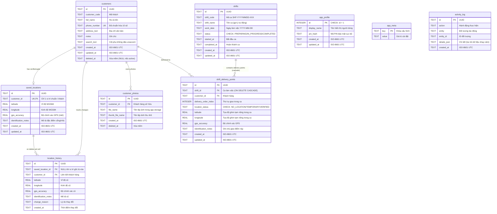

# Kế Hoạch Chuyển Đổi Mô Hình Dữ Liệu Local-First (Local-First Transition Plan)

> **Dự án:** Delivery Location Marker System (`mobile_app`)  
> **Mục tiêu:** Chuyển đổi ứng dụng từ mô hình Client-Server tập trung sang mô hình **Local-First** (mỗi người dùng tự quản lý dữ liệu trực tiếp trên thiết bị, hoạt động độc lập không phụ thuộc kết nối mạng hay bắt buộc đăng nhập tài khoản/quản trị).  
> **Nguyên tắc bảo toàn:** Giữ nguyên toàn bộ mã nguồn Backend (`backend/`) và Admin Web (`admin_web/`) trong kho lưu trữ để sẵn sàng kết nối lại hoặc đồng bộ P2P/Cloud trong tương lai.  
> **Quy chuẩn thực thi:** Tuân thủ [AGENTS.md](file:///d:/flutter%20create%20delivery_marker_app/AGENTS.md), không làm thay đổi giao diện, luồng nghiệp vụ hoặc mô hình dữ liệu hiện tại khi tách lớp.

---

## 1. Khảo Sát Hiện Trạng Gọi Dữ Liệu (`ApiService` Call Mapping)

Tổng số vị trí gọi `ApiService` trong `mobile_app/lib`: **101 vị trí**.

| Màn Hình / Widget | Hàm `ApiService` Đang Dùng | Nhóm Chức Năng | Phân Loại Xử Lý |
| :--- | :--- | :--- | :--- |
| [main.dart](file:///d:/flutter%20create%20delivery_marker_app/mobile_app/lib/main.dart) | `getToken()` | Khác (Khởi tạo phiên) | Còn dùng `ApiService` trực tiếp |
| [login_view.dart](file:///d:/flutter%20create%20delivery_marker_app/mobile_app/lib/views/login_view.dart) | `getSavedLoginPhone()` | Tài khoản / Đăng nhập | `ProfileRepository` |
| [login_view.dart](file:///d:/flutter%20create%20delivery_marker_app/mobile_app/lib/views/login_view.dart) | `login()` | Tài khoản / Đăng nhập | `ProfileRepository` |
| [login_view.dart](file:///d:/flutter%20create%20delivery_marker_app/mobile_app/lib/views/login_view.dart) | `getBaseUrl()`, `resetCustomBaseUrl()`, `setCustomBaseUrl()` | Cấu hình máy chủ | Còn dùng `ApiService` trực tiếp |
| [account_profile_view.dart](file:///d:/flutter%20create%20delivery_marker_app/mobile_app/lib/views/account_profile_view.dart) | `getCurrentUser()` | Tài khoản / Hồ sơ | `ProfileRepository` |
| [account_profile_view.dart](file:///d:/flutter%20create%20delivery_marker_app/mobile_app/lib/views/account_profile_view.dart) | `getMyAreas()` | Tài khoản / Khu vực | `ProfileRepository` |
| [account_profile_view.dart](file:///d:/flutter%20create%20delivery_marker_app/mobile_app/lib/views/account_profile_view.dart) | `getMyStats()` | Tài khoản / Thống kê | `ProfileRepository` |
| [account_profile_view.dart](file:///d:/flutter%20create%20delivery_marker_app/mobile_app/lib/views/account_profile_view.dart) | `logout()` | Tài khoản / Đăng nhập | `ProfileRepository` |
| [account_profile_view.dart](file:///d:/flutter%20create%20delivery_marker_app/mobile_app/lib/views/account_profile_view.dart) | `getBaseUrl()`, `resetCustomBaseUrl()`, `setCustomBaseUrl()` | Cấu hình máy chủ | Còn dùng `ApiService` trực tiếp |
| [change_password_view.dart](file:///d:/flutter%20create%20delivery_marker_app/mobile_app/lib/views/change_password_view.dart) | `changePassword()` | Tài khoản / Đổi mật khẩu | `ProfileRepository` |
| [customer_directory_view.dart](file:///d:/flutter%20create%20delivery_marker_app/mobile_app/lib/views/customer_directory_view.dart) | `getCustomersResponse()` | Khách hàng (Danh bạ phân trang) | `CustomerRepository` |
| [customer_directory_view.dart](file:///d:/flutter%20create%20delivery_marker_app/mobile_app/lib/views/customer_directory_view.dart) | `getCustomerDetail()` | Khách hàng (Chi tiết hồ sơ) | `CustomerRepository` |
| [customer_directory_view.dart](file:///d:/flutter%20create%20delivery_marker_app/mobile_app/lib/views/customer_directory_view.dart) | `updateCustomer()` | Khách hàng (Cập nhật thông tin) | `CustomerRepository` |
| [customer_directory_view.dart](file:///d:/flutter%20create%20delivery_marker_app/mobile_app/lib/views/customer_directory_view.dart) | `getShifts()`, `getShiftDetail()` | Ca làm việc | `ShiftRepository` |
| [customer_directory_view.dart](file:///d:/flutter%20create%20delivery_marker_app/mobile_app/lib/views/customer_directory_view.dart) | `addPointToShift()`, `removePointFromShift()` | Điểm trong ca | `ShiftRepository` |
| [customer_directory_view.dart](file:///d:/flutter%20create%20delivery_marker_app/mobile_app/lib/views/customer_directory_view.dart) | `deleteCustomerLocation()` | Vị trí (Xóa vị trí) | `LocationRepository` |
| [customer_directory_view.dart](file:///d:/flutter%20create%20delivery_marker_app/mobile_app/lib/views/customer_directory_view.dart) | `updateCustomerLocationAndPhoto()` | Vị trí (Lưu tọa độ & ghi chú) | `LocationRepository` |
| [data_sharing_view.dart](file:///d:/flutter%20create%20delivery_marker_app/mobile_app/lib/views/data_sharing_view.dart) | `getOutgoingShares()`, `getIncomingShares()` | Chia sẻ dữ liệu | `SharingRepository` |
| [data_sharing_view.dart](file:///d:/flutter%20create%20delivery_marker_app/mobile_app/lib/views/data_sharing_view.dart) | `getShifts()` | Ca làm việc (Chọn ca chia sẻ) | `ShiftRepository` |
| [data_sharing_view.dart](file:///d:/flutter%20create%20delivery_marker_app/mobile_app/lib/views/data_sharing_view.dart) | `createShare()`, `revokeShare()`, `acceptShare()`, `declineShare()`, `importSharedLocations()` | Chia sẻ dữ liệu | `SharingRepository` |
| [shift_list_view.dart](file:///d:/flutter%20create%20delivery_marker_app/mobile_app/lib/views/shift_list_view.dart) | `getShifts()`, `updateShiftName()`, `deleteShift()` | Ca làm việc | `ShiftRepository` |
| [shift_list_view.dart](file:///d:/flutter%20create%20delivery_marker_app/mobile_app/lib/views/shift_list_view.dart) | `logout()` | Tài khoản / Đăng nhập | `ProfileRepository` |
| [shift_preparation_view.dart](file:///d:/flutter%20create%20delivery_marker_app/mobile_app/lib/views/shift_preparation_view.dart) | `getShiftDetail()`, `updateShiftStatus()` | Ca làm việc | `ShiftRepository` |
| [shift_preparation_view.dart](file:///d:/flutter%20create%20delivery_marker_app/mobile_app/lib/views/shift_preparation_view.dart) | `lookupCustomerLocationByPhone()` | Khách hàng (Tra cứu SĐT) | `CustomerRepository` |
| [shift_preparation_view.dart](file:///d:/flutter%20create%20delivery_marker_app/mobile_app/lib/views/shift_preparation_view.dart) | `addPointToShift()`, `removePointFromShift()` | Điểm trong ca | `ShiftRepository` |
| [shift_map_view.dart](file:///d:/flutter%20create%20delivery_marker_app/mobile_app/lib/views/shift_map_view.dart) | `getShiftDetail()` | Ca làm việc | `ShiftRepository` |
| [shift_map_view.dart](file:///d:/flutter%20create%20delivery_marker_app/mobile_app/lib/views/shift_map_view.dart) | `openExternalNavigation()` | Tiện ích mở Google Maps | Còn dùng `ApiService` trực tiếp |
| [crosshair_location_picker_view.dart](file:///d:/flutter%20create%20delivery_marker_app/mobile_app/lib/views/crosshair_location_picker_view.dart) | `searchAddress()` | Geocoding (OSM Nominatim) | Còn dùng `ApiService` trực tiếp |
| [crosshair_location_picker_view.dart](file:///d:/flutter%20create%20delivery_marker_app/mobile_app/lib/views/crosshair_location_picker_view.dart) | `updateTemporaryLocation()` | Vị trí / Điểm trong ca | `LocationRepository` |
| [main_map_view.dart](file:///d:/flutter%20create%20delivery_marker_app/mobile_app/lib/views/main_map_view.dart) | `getMySavedLocations()` | Vị trí (Tọa độ đã lưu) | `LocationRepository` |
| [main_map_view.dart](file:///d:/flutter%20create%20delivery_marker_app/mobile_app/lib/views/main_map_view.dart) | `getCustomers()`, `createCustomer()`, `lookupCustomerLocationByPhone()` | Khách hàng | `CustomerRepository` |
| [main_map_view.dart](file:///d:/flutter%20create%20delivery_marker_app/mobile_app/lib/views/main_map_view.dart) | `getSharedLocations()`, `importSharedLocations()` | Chia sẻ dữ liệu | `SharingRepository` |
| [main_map_view.dart](file:///d:/flutter%20create%20delivery_marker_app/mobile_app/lib/views/main_map_view.dart) | `getPreferredAreaId()` | Tài khoản / Khu vực | `ProfileRepository` |
| [main_map_view.dart](file:///d:/flutter%20create%20delivery_marker_app/mobile_app/lib/views/main_map_view.dart) | `updateCustomerLocationAndPhoto()` | Vị trí | `LocationRepository` |
| [main_map_view.dart](file:///d:/flutter%20create%20delivery_marker_app/mobile_app/lib/views/main_map_view.dart) | `searchAddress()` | Geocoding | Còn dùng `ApiService` trực tiếp |
| [main_map_view.dart](file:///d:/flutter%20create%20delivery_marker_app/mobile_app/lib/views/main_map_view.dart) | `openExternalNavigation()` | Tiện ích ngoài | Còn dùng `ApiService` trực tiếp |
| [save_location_view.dart](file:///d:/flutter%20create%20delivery_marker_app/mobile_app/lib/views/save_location_view.dart) | `saveCustomerLocation()` | Vị trí | `LocationRepository` |
| [delivery_map_view.dart](file:///d:/flutter%20create%20delivery_marker_app/mobile_app/lib/views/delivery_map_view.dart) *(Legacy)* | `getMyShiftOrders()`, `addOrderToShift()` | Ca làm việc / Đơn hàng | `ShiftRepository` |
| [delivery_map_view.dart](file:///d:/flutter%20create%20delivery_marker_app/mobile_app/lib/views/delivery_map_view.dart) *(Legacy)* | `getPendingSyncCount()`, `syncOfflineQueue()` | Vị trí / Hàng đợi offline | `LocationRepository` |
| [delivery_map_view.dart](file:///d:/flutter%20create%20delivery_marker_app/mobile_app/lib/views/delivery_map_view.dart) *(Legacy)* | `lookupCustomerLocationByPhone()` | Khách hàng | `CustomerRepository` |
| [delivery_map_view.dart](file:///d:/flutter%20create%20delivery_marker_app/mobile_app/lib/views/delivery_map_view.dart) *(Legacy)* | `logout()` | Tài khoản / Đăng nhập | `ProfileRepository` |
| [delivery_map_view.dart](file:///d:/flutter%20create%20delivery_marker_app/mobile_app/lib/views/delivery_map_view.dart) *(Legacy)* | `getPhotoAuthInfo()`, `openExternalNavigation()` | Ảnh / Tiện ích ngoài | `PhotoRepository` / `ApiService` |
| [order_list_view.dart](file:///d:/flutter%20create%20delivery_marker_app/mobile_app/lib/views/order_list_view.dart) *(Legacy)* | `getMyShiftOrders()` | Ca làm việc / Đơn hàng | `ShiftRepository` |
| [order_list_view.dart](file:///d:/flutter%20create%20delivery_marker_app/mobile_app/lib/views/order_list_view.dart) *(Legacy)* | `getPendingSyncCount()`, `syncOfflineQueue()` | Vị trí / Hàng đợi offline | `LocationRepository` |
| [order_list_view.dart](file:///d:/flutter%20create%20delivery_marker_app/mobile_app/lib/views/order_list_view.dart) *(Legacy)* | `logout()` | Tài khoản / Đăng nhập | `ProfileRepository` |
| [order_detail_view.dart](file:///d:/flutter%20create%20delivery_marker_app/mobile_app/lib/views/order_detail_view.dart) *(Legacy)* | `lookupCustomerLocationByPhone()` | Khách hàng | `CustomerRepository` |
| [order_detail_view.dart](file:///d:/flutter%20create%20delivery_marker_app/mobile_app/lib/views/order_detail_view.dart) *(Legacy)* | `getPhotoAuthInfo()`, `openExternalNavigation()` | Ảnh / Tiện ích ngoài | `PhotoRepository` / `ApiService` |
| [bulk_paste_phone_sheet.dart](file:///d:/flutter%20create%20delivery_marker_app/mobile_app/lib/widgets/bulk_paste_phone_sheet.dart) | `getMyAreas()` | Tài khoản / Khu vực | `ProfileRepository` |
| [bulk_paste_phone_sheet.dart](file:///d:/flutter%20create%20delivery_marker_app/mobile_app/lib/widgets/bulk_paste_phone_sheet.dart) | `createBulkCustomers()` | Khách hàng (Dán hàng loạt) | `CustomerRepository` |
| [bulk_paste_phone_sheet.dart](file:///d:/flutter%20create%20delivery_marker_app/mobile_app/lib/widgets/bulk_paste_phone_sheet.dart) | `getShifts()`, `addBulkPointsToShift()` | Ca làm việc (Dán vào ca) | `ShiftRepository` |
| [quick_add_customer_sheet.dart](file:///d:/flutter%20create%20delivery_marker_app/mobile_app/lib/widgets/quick_add_customer_sheet.dart) | `getMyAreas()`, `getPreferredAreaId()`, `setPreferredAreaId()`, `clearPreferredAreaId()` | Tài khoản / Khu vực | `ProfileRepository` |
| [quick_add_customer_sheet.dart](file:///d:/flutter%20create%20delivery_marker_app/mobile_app/lib/widgets/quick_add_customer_sheet.dart) | `createCustomer()` | Khách hàng (Tạo nhanh) | `CustomerRepository` |
| [create_shift_dialog.dart](file:///d:/flutter%20create%20delivery_marker_app/mobile_app/lib/widgets/create_shift_dialog.dart) | `getShifts()`, `createShift()` | Ca làm việc | `ShiftRepository` |
| [shift_picker_bottom_sheet.dart](file:///d:/flutter%20create%20delivery_marker_app/mobile_app/lib/widgets/shift_picker_bottom_sheet.dart) | `getShifts()`, `updateShiftName()`, `deleteShift()` | Ca làm việc | `ShiftRepository` |
| [customer_photos_strip_widget.dart](file:///d:/flutter%20create%20delivery_marker_app/mobile_app/lib/widgets/customer_photos_strip_widget.dart) | `getCustomerPhotos()`, `addCustomerPhoto()`, `deleteCustomerPhoto()` | Ảnh khách hàng | `PhotoRepository` |
| [authenticated_image.dart](file:///d:/flutter%20create%20delivery_marker_app/mobile_app/lib/widgets/authenticated_image.dart) | `getPhotoAuthInfo()` | Ảnh (Auth headers) | `PhotoRepository` |
| [fullscreen_image_viewer.dart](file:///d:/flutter%20create%20delivery_marker_app/mobile_app/lib/widgets/fullscreen_image_viewer.dart) | `getPhotoAuthInfo()` | Ảnh (Auth headers) | `PhotoRepository` |
| [point_detail_bottom_sheet.dart](file:///d:/flutter%20create%20delivery_marker_app/mobile_app/lib/widgets/point_detail_bottom_sheet.dart) | `openExternalNavigation()` | Tiện ích ngoài | Còn dùng `ApiService` trực tiếp |

---

## 2. Thiết Kế Các Nhóm Repository Trừu Tượng

Cấu trúc thư mục mới: `mobile_app/lib/repositories/`:
```
lib/repositories/
├── customer_repository.dart
├── location_repository.dart
├── photo_repository.dart
├── shift_repository.dart
├── sharing_repository.dart
├── profile_repository.dart
├── remote/
│   ├── remote_customer_repository.dart
│   ├── remote_location_repository.dart
│   ├── remote_photo_repository.dart
│   ├── remote_shift_repository.dart
│   ├── remote_sharing_repository.dart
│   └── remote_profile_repository.dart
└── repository_provider.dart
```

### 2.1. CustomerRepository
Quản lý dữ liệu danh bạ khách hàng, tìm kiếm, tra cứu SĐT và tạo hàng loạt:
- `getCustomers({String? areaId}) -> Future<List<CustomerDirectoryModel>>`
- `getCustomersResponse({int page, int limit, String? search, String? areaId, String? locationStatus}) -> Future<CustomerDirectoryResponse>`
- `getCustomerDetail(String customerId) -> Future<CustomerDirectoryModel>`
- `createCustomer({required String fullName, required String phoneNumber, String? addressText, String? areaId, double? latitude, double? longitude, String? identificationNotes, String? base64Photo}) -> Future<CustomerDirectoryModel>`
- `createBulkCustomers({required List<String> phoneNumbers, String? areaId}) -> Future<BulkCreateCustomerResult>`
- `updateCustomer({required String customerId, required String fullName, required String phoneNumber, String? addressText, String? areaId}) -> Future<void>`
- `lookupCustomerLocationByPhone(String phone) -> Future<CustomerLookupResult>`

### 2.2. LocationRepository
Quản lý tọa độ vị trí ghim cổng, điểm tạm, xác minh và đồng bộ offline:
- `getMySavedLocations() -> Future<List<LocationModel>>`
- `saveCustomerLocation({required String customerId, required double latitude, required double longitude, required String identificationNotes, String? base64Photo, double? gpsAccuracy}) -> Future<bool>`
- `updateCustomerLocationAndPhoto({required String customerId, required double latitude, required double longitude, required String identificationNotes, String? base64Photo}) -> Future<void>`
- `deleteCustomerLocation(String customerId) -> Future<void>`
- `updateTemporaryLocation({required String shiftId, required String pointId, required double latitude, required double longitude, String? notes}) -> Future<ShiftDeliveryPointModel>`
- `verifyPointLocation({required String shiftId, required String pointId, required double latitude, required double longitude, required double gpsAccuracy, required String identificationNotes, String? base64Photo}) -> Future<ShiftDeliveryPointModel>`
- `getPendingSyncCount() -> Future<int>`
- `syncOfflineQueue() -> Future<void>`

### 2.3. PhotoRepository
Quản lý tải, nén, lưu và xóa ảnh mặt tiền nhà:
- `getCustomerPhotos(String customerId) -> Future<List<CustomerPhotoModel>>`
- `addCustomerPhoto(String customerId, String base64Image) -> Future<CustomerPhotoModel>`
- `deleteCustomerPhoto(String customerId, String photoId) -> Future<void>`
- `getPhotoAuthInfo(String url) -> Future<Map<String, String>>`

### 2.4. ShiftRepository
Quản lý ca làm việc, thêm/xóa điểm giao trong ca, dán hàng loạt vào ca:
- `getShifts({String? status}) -> Future<List<ShiftModel>>`
- `createShift({String? shiftName}) -> Future<ShiftModel>`
- `getShiftDetail(String shiftId) -> Future<ShiftModel>`
- `updateShiftName(String shiftId, String shiftName) -> Future<ShiftModel>`
- `updateShiftStatus(String shiftId, String status) -> Future<ShiftModel>`
- `deleteShift(String shiftId) -> Future<void>`
- `addPointToShift({required String shiftId, required String customerPhone, String? customerName, String? customerAddress, double? latitude, double? longitude, String? locationNotes}) -> Future<AddShiftPointResult>`
- `addBulkPointsToShift({required String shiftId, required List<String> phoneNumbers, String? areaId}) -> Future<BulkAddPointsResult>`
- `removePointFromShift(String shiftId, String pointId) -> Future<void>`
- `getMyShiftOrders() -> Future<List<OrderModel>>`
- `addOrderToShift({required String customerId}) -> Future<Map<String, dynamic>>`

### 2.5. SharingRepository
Quản lý yêu cầu chia sẻ dữ liệu vị trí giữa các shipper:
- `getOutgoingShares() -> Future<List<DataShareModel>>`
- `getIncomingShares() -> Future<List<DataShareModel>>`
- `getSharedLocations() -> Future<List<SharedLocationItem>>`
- `createShare({required String recipientPhone, required String shareScope, String? shiftId, int? durationHours, String? notes}) -> Future<DataShareModel>`
- `acceptShare(String shareId) -> Future<DataShareModel>`
- `declineShare(String shareId) -> Future<DataShareModel>`
- `revokeShare(String shareId) -> Future<DataShareModel>`
- `importSharedLocations({required String shareId, List<String>? customerIds}) -> Future<ImportShareResult>`

### 2.6. ProfileRepository
Quản lý hồ sơ người dùng, phân quyền khu vực ưa thích và thông tin tài khoản:
- `login(String phone, String password) -> Future<UserModel>`
- `logout() -> Future<void>`
- `getCurrentUser() -> Future<UserModel?>`
- `getMyStats() -> Future<UserStatsModel>`
- `getMyAreas() -> Future<List<Map<String, dynamic>>>`
- `getPreferredAreaId() -> Future<String?>`
- `setPreferredAreaId(String areaId) -> Future<void>`
- `clearPreferredAreaId() -> Future<void>`
- `changePassword({required String currentPassword, required String newPassword}) -> Future<Map<String, dynamic>>`
- `getSavedLoginPhone() -> Future<String?>`

---

## 3. Quản Lý Phụ Thuộc (RepositoryProvider / ServiceLocator)

Tạo lớp `RepositoryProvider` đơn giản, không phụ thuộc thư viện nặng:
- Giữ instance singleton hoặc cho phép ghi đè (override) trong kiểm thử widget test (`RepositoryProvider.override(...)` hoặc `RepositoryProvider.reset()`).
- Mặc định: Trỏ về các `RemoteRepository` tương ứng bọc `ApiService`.
- Mở rộng tương lai: Thay thế bằng `LocalCustomerRepository`, `LocalLocationRepository`,... kết nối CSDL SQLite `OfflineStorageService` khi người dùng kích hoạt chế độ thuần Local-First.

---

## 4. Danh Sách Các Lời Gọi Còn Dùng `ApiService` Trực Tiếp

Các lời gọi sau đây không thuộc 6 nhóm nghiệp vụ quản lý dữ liệu đối tượng khách/vị trí/ca/chia sẻ/hồ sơ, mà là các tiện ích giao tiếp hạ tầng mạng / phần cứng hệ thống:
1. **Quản lý Token phiên hệ thống:**
   - `ApiService.getToken()` tại [main.dart](file:///d:/flutter%20create%20delivery_marker_app/mobile_app/lib/main.dart).
2. **Cấu hình địa chỉ mạng nội bộ:**
   - `ApiService.getBaseUrl()`, `ApiService.setCustomBaseUrl()`, `ApiService.resetCustomBaseUrl()` tại [login_view.dart](file:///d:/flutter%20create%20delivery_marker_app/mobile_app/lib/views/login_view.dart) và [account_profile_view.dart](file:///d:/flutter%20create%20delivery_marker_app/mobile_app/lib/views/account_profile_view.dart).
3. **Geocoding tìm kiếm địa chỉ OpenStreetMap / Nominatim:**
   - `ApiService.searchAddress(query)` tại [crosshair_location_picker_view.dart](file:///d:/flutter%20create%20delivery_marker_app/mobile_app/lib/views/crosshair_location_picker_view.dart) và [main_map_view.dart](file:///d:/flutter%20create%20delivery_marker_app/mobile_app/lib/views/main_map_view.dart).
4. **Tiện ích mở ứng dụng dẫn đường ngoài (Google Maps):**
   - `ApiService.openExternalNavigation(lat, lng)` tại [point_detail_bottom_sheet.dart](file:///d:/flutter%20create%20delivery_marker_app/mobile_app/lib/widgets/point_detail_bottom_sheet.dart), [shift_map_view.dart](file:///d:/flutter%20create%20delivery_marker_app/mobile_app/lib/views/shift_map_view.dart), [main_map_view.dart](file:///d:/flutter%20create%20delivery_marker_app/mobile_app/lib/views/main_map_view.dart), [delivery_map_view.dart](file:///d:/flutter%20create%20delivery_marker_app/mobile_app/lib/views/delivery_map_view.dart), [order_detail_view.dart](file:///d:/flutter%20create%20delivery_marker_app/mobile_app/lib/views/order_detail_view.dart).

---

## 5. Sơ Đồ Cơ Sở Dữ Liệu SQLite Cục Bộ (Local SQLite Schema - `local_data_v1.db`)

> **Quyết định kiến trúc (TASK: LOCAL-FIRST-02-SQLITE-SCHEMA):**
> - **Tách biệt hoàn toàn:** Tạo tệp cơ sở dữ liệu mới `local_data_v1.db` do [app_database.dart](file:///d:/flutter%20create%20delivery_marker_app/mobile_app/lib/local/app_database.dart) quản lý.
> - **Bảo toàn:** Giữ nguyên tệp `delivery_offline_v2.db` cùng [offline_storage_service.dart](file:///d:/flutter%20create%20delivery_marker_app/mobile_app/lib/services/offline_storage_service.dart) để tránh làm ảnh hưởng đến hàng đợi đồng bộ cũ và các bài test đã có.
> - **Cấu hình động cơ SQLite:**
>   - Bắt buộc bật `PRAGMA foreign_keys = ON;` qua hook `onConfigure`.
>   - Kích hoạt chế độ `PRAGMA journal_mode = WAL;` (Write-Ahead Logging) cho hiệu năng đọc/ghi đồng thời tối ưu.
>   - Cơ chế migration theo phiên bản (`user_version`, `onCreate`, `onUpgrade` chạy tuần tự trong transaction).
>   - Định danh `id` dạng TEXT UUID v4 sinh trực tiếp tại app qua [uuid_utils.dart](file:///d:/flutter%20create%20delivery_marker_app/mobile_app/lib/utils/uuid_utils.dart).
>   - Thời gian lưu trữ theo định dạng chuẩn ISO-8601 UTC (`YYYY-MM-DDTHH:mm:ss.sssZ`).



### 5.1. Quy Tắc Nghiệp Vụ Cốt Lõi Được Đảm Bảo Bằng Ràng Buộc CSDL

1. **Vị Trí Đã Xác Minh vs. Vị Trí Ghim Tạm:**
   - `saved_locations` chỉ chứa vị trí cổng nhà đã được xác minh (`VERIFIED`) chính thức của khách hàng.
   - Vị trí ghim tạm (`TEMPORARY`) trước khi đi giao chỉ tồn tại cục bộ trong ca làm việc tại bảng `shift_delivery_points` (`location_status = 'TEMPORARY'`), không ghi đè vào `saved_locations`.
2. **Bảo Toàn Khách Hàng Khi Xóa Ca:**
   - `shift_delivery_points` có khóa ngoại `FOREIGN KEY (shift_id) REFERENCES shifts(id) ON DELETE CASCADE`.
   - Bảng `customers` và `saved_locations` **không** bị phụ thuộc khóa ngoại cascade từ `shifts`. Khi xóa ca làm việc, toàn bộ khách hàng và vị trí đã lưu hoàn toàn nguyên vẹn.
3. **Bảo Toàn Lịch Sử Đối Soát Khi Xóa Vị Trí:**
   - `location_history` có khóa ngoại `FOREIGN KEY (saved_location_id) REFERENCES saved_locations(id) ON DELETE SET NULL`.
   - Trigger SQLite `trg_saved_locations_history` tự động sinh bản ghi lưu lại tọa độ và ghi chú cũ mỗi khi có thao tác `UPDATE` thay đổi tọa độ/ghi chú.
   - Khi xóa dòng trong `saved_locations`, các bản ghi lịch sử tương ứng vẫn tồn tại nguyên vẹn, chỉ có trường `saved_location_id` tự động chuyển về `NULL`.
4. **Ngăn Ngừa Trùng Lặp Trong Ca:**
   - Khóa duy nhất tổ hợp `UNIQUE(shift_id, customer_id)` chặn tuyệt đối hành vi thêm một khách hàng nhiều lần vào cùng một ca.
5. **Tìm Kiếm Thông Minh Không Dấu (Vietnamese Unaccent):**
   - Cột phụ `search_text` trong bảng `customers` được tự động sinh đồng bộ qua [vietnamese_utils.dart](file:///d:/flutter%20create%20delivery_marker_app/mobile_app/lib/utils/vietnamese_utils.dart).
   - Cho phép người dùng tìm kiếm theo `"Nguyen Xien"` khớp chính xác `"Nguyễn Xiển"`, tìm theo SĐT có khoảng cách/dấu chấm (`"0909 112 233"`) khớp `"0909112233"`.
6. **Chuẩn Hóa Số Điện Thoại Dùng Chung:**
   - Hàm `normalizeCustomerPhone` được tách ra [phone_utils.dart](file:///d:/flutter%20create%20delivery_marker_app/mobile_app/lib/utils/phone_utils.dart) đảm bảo mọi số điện thoại nhập từ giao diện (Thêm nhanh khách, dán SĐT, tra cứu) đều được chuẩn hóa về 10 chữ số bắt đầu bằng `0` trước khi lưu.

